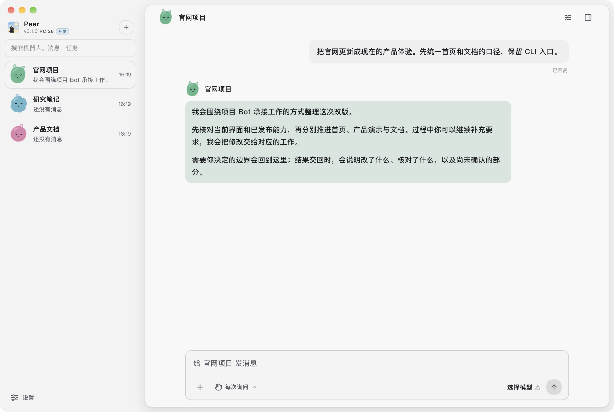

<p align="center"></p>

<h1 align="center">Peer Agent</h1>

<p align="center"><strong>Hand over the work. Keep the decisions.</strong></p>
<p align="center">A project Bot that coordinates Agents, follows the work and brings back results with evidence.</p>
<p align="center">Open source under MIT · Local execution and authorization · Desktop and CLI</p>
<p align="center"><strong>English</strong> · <a href="README.zh-CN.md">简体中文</a> · <a href="https://ly-ccx.github.io/Peer-Agent/">Website</a> · <a href="https://ly-ccx.github.io/Peer-Agent/docs.html">Documentation</a> · <a href="https://github.com/ly-ccx/Peer-Agent/releases">Downloads</a></p>

Peer is a local work delegation system for people moving code, documents and research across projects. Give the project Bot a goal and boundaries. It reads the project, arranges scoped execution, coordinates additions and questions, and checks the returned work.

You keep the important decisions and permissions. Tasks, plans and success criteria organize execution behind the project conversation.

> **Choose the matching version.** The project Bot experience belongs to the **0.1 preview**, currently beta channel **`0.1.0-rc.29`** (npm `rc`). Current stable release: **`0.0.18`** (npm `latest`), which uses the classic interface. RC29 includes the recent durable-supervision and withdrawal fixes. Release and npm channel facts were checked on 2026-10-29.



The screenshot is from the actual 0.1 Desktop renderer, using fictional project data and a scripted conversation. It illustrates the interface; it is not a real-model execution or installed-release acceptance record.

## Why Peer

- **A project relationship that lasts.** The folder, goals, memory and history remain available as the work continues.
- **One point of contact.** The main Bot coordinates work Agents and sends additions to the responsible work.
- **Results with a basis.** The returned explanation distinguishes changes, checks actually performed and outstanding gaps.
- **Authority stays local.** Tools run through local capability and permission contracts. A model reply cannot create a permission grant or evidence.
- **An open foundation.** Desktop, CLI, runtime, protocol and capability manifests share the MIT license.

<a id="-task-flow-handoff-continuity-follow-up"></a>

## Working together

1. **Set a goal and boundary.** For example: “Investigate this latency. Explain the cause before changing the public API.”
2. **Let the project Bot organize execution.** Work Agents receive scoped goals and success criteria; independent work can move in parallel.
3. **Keep talking while work progresses.** Add context, correct direction or ask to stop in the project conversation.
4. **Return for decisions that need you.** Permissions, meaningful scope choices and genuine user questions remain yours.
5. **Inspect the result and its basis.** The Bot explains what changed, what was checked and what remains uncertain. Reports, diffs and evidence stay available.

Ordinary work questions should return to the main Bot for coordination. Technical interruptions, a paused task and an unknown tool outcome remain different facts. Recovery preserves context and existing work; unknown operations are not blindly replayed.

RC29 strengthens durable supervision and withdrawal settlement. Withdrawing a delegation preserves its history and may retain an unknown historical outcome; it does not prove that an external effect was rolled back. Consult the release notes for what your installed build contains.

## What you can delegate

| Work | Example goal | What to inspect on return |
| --- | --- | --- |
| Investigation and repair | Find why a request is slow and fix the cause | Cause, diff and checks actually performed |
| Engineering changes | Update a feature across the project while keeping compatibility | Related changes, verification findings and remaining gaps |
| Research and documentation | Compare approaches and write a recommendation | Conclusions, source references and open questions |

In the 0.1 preview, the Workspace beside the conversation opens web pages, documents, code, directories and diffs. Reading a result, authorizing a write, accepting work and integrating Git changes are distinct actions.

<a id="-quick-start"></a>

## Get started

### Project Bot Desktop preview

1. Open the [0.1.0-rc.29 release](https://github.com/ly-ccx/Peer-Agent/releases/tag/v0.1.0-rc.29), choose an available platform asset and read its upgrade notes.
2. Add a model service in Settings and select a model suited to the work.
3. Bind a folder or create a managed project Bot.
4. Give it a goal and boundaries. Start with a read-only project question if you want to understand the folder first.
5. Use the main conversation for additions and decisions; open task details or the Workspace for supporting material.

Back up the complete data directory before upgrading. Upgrade Desktop, CLI/TUI and Gateway according to the same release instructions. Rollback follows the release-specific backup procedure.

On Linux x64, choose `Peer-Agent-<ver>-x64.AppImage` (preferred) or `.deb`. Both are unsigned, and in-app updates are AppImage-only (`latest-linux.yml`). Read the release notes for AppImage dependencies and display-server guidance.

The [stable 0.0.18 release](https://github.com/ly-ccx/Peer-Agent/releases/tag/v0.0.18) uses classic workflows.

### CLI / TUI

Preview channel:

    npm install -g @peer-agent/cli@rc
    peer --version
    peer

Stable channel:

    npm install -g @peer-agent/cli

The npm package installs the platform binary and its helper. Available platforms and artifacts are listed on the corresponding release page. The npm beta tag is an older beta channel, not the current RC. See the [CLI reference](https://ly-ccx.github.io/Peer-Agent/docs.html#cli) for modes and scripted usage.

### Run the 0.1 source

Use Node.js 25 (the current CI version), pnpm 10.22.0 and a Rust toolchain. Bun is needed for the TUI. Native credential storage requires the appropriate OS build dependencies.

    git clone --branch PeerAgent/dev/0.1.0 https://github.com/ly-ccx/Peer-Agent.git
    cd Peer-Agent
    pnpm install --frozen-lockfile
    pnpm dev

For the TUI:

    pnpm --filter @peer-agent/tui dev

To package Linux Desktop x64 (the AppImage and `.deb` need libdbus-1-dev, fakeroot and dpkg):

    pnpm pack:linux    # unpacked directory for sandbox and smoke checks
    pnpm dist:linux    # AppImage + .deb

## Local control and evidence

Models provide cognition and may run with a cloud provider. Peer controls local capability execution, permission decisions and evidence. What a model receives depends on the configured provider and admitted context; local-first is not a claim that no content can leave the computer.

The project Bot remains a reader and coordinator. Work Agents execute under the local capability chain and granted scope. The main Bot does not approve permissions for you.

A completed reply is not a completed delegation. Verification, acceptance and integration follow structured host facts and the applicable policy. A continuity summary is context, not a substitute for tool results or evidence.

## Extensions

| Capability | Entry |
| --- | --- |
| Model providers and routing | [Connect a model](https://ly-ccx.github.io/Peer-Agent/docs.html#model) |
| External tool servers | [MCP](https://ly-ccx.github.io/Peer-Agent/docs.html#mcp) |
| Reusable instruction packages | [Skills](https://ly-ccx.github.io/Peer-Agent/docs.html#skill) |
| Capability packages and local adapters | [Plugins](https://ly-ccx.github.io/Peer-Agent/docs.html#plugin) |
| Embed the governed runtime | [Runtime SDK](packages/runtime-sdk/README.md) |
| Terminal and scripted access | [CLI](packages/npm-cli/README.md) |

Extensions follow the same capability, projection, permission and evidence boundaries. They do not create a separate execution path.

<a id="-architecture-at-a-glance"></a>

## Architecture at a glance


The architecture starts from a single point: the **agent runtime**. Everything else is a layer peeled off it.

### Layer 1: The runtime core — capability, authorization, evidence

The bottom layer answers one question: *when the model wants a local capability, on what authority does it run, and how is it proven?*

```text
Capability Provider → Manifest → Runtime Projection → Tool Call → PermissionGrant → Evidence
```

`@peer-agent/runtime-core` is the pure implementation of this core: capability registry, manifests, projection, authorization, and Evidence primitives, plus context compaction and accounting. It knows nothing of Electron, terminals, or any product shape — only contracts. `@peer-agent/protocol` defines the contracts themselves (chat, execution, goal, system-context, automation, compaction — 13 domains) as cross-layer types, so every layer speaks the same language.

**No side doors.** Bash, files, search, MCP, plugins, skills — every capability flows through the same chain. That is the non-negotiable part of this architecture.

### Layer 2: System Context — what the model sees

The runtime executes capabilities, but the model first needs *context*. `@peer-agent/system-context` is the canonical assembler for System Context: prompt-source registration, layering, checksums, and snapshots. Project instructions, mode reminders, tool prompts, and compact summaries enter through explicit Context Sources — not scattered string concatenation. Tool output and file content are factual context and are never promoted into system instructions.

### Layer 3: The execution lifecycle behind delegated work

Above capability and context sits the machinery of tasks: `@peer-agent/chat-kernel` (reducer-driven conversation state machine) and `@peer-agent/task-thread` (task-thread event model) carry handoff, continuity, and follow-up; the goal contract defines GoalPlans, subtasks, and success criteria; `@peer-agent/conversation-store` persists it all so tasks survive across sessions.

### Layer 4: The Node host — landing on a real machine

`@peer-agent/runtime-node` lands the core in a Node environment: MCP server integration, the Automation scheduler, the chat runtime, and encrypted credentials (with `@peer-agent/credential-helper` and the system Secret Service). `@peer-agent/runtime-sdk` opens the same orchestration to any Node host for embedding.

### The surface layer: expression and interaction

Desktop (`apps/desktop`), TUI, and CLI (`apps/tui` + `@peer-agent/cli`) do expression and interaction only — they hold no execution truth. Host-neutrality is not a slogan, it is a dependency fact: the TUI depends on no UI packages, only on `protocol + runtime-core + runtime-node + runtime-sdk + system-context`; Desktop additionally uses `chat-kernel / task-thread / ui / i18n`. One machine, one `~/.peer-agent` — different surfaces, one truth.

```text
┌──────────────────────────────────────────────────────────┐
│  Desktop / TUI / CLI        (expression + interaction)  │
└───────────────────────────┬──────────────────────────────┘
                            │ protocol / IPC
┌───────────────────────────▼──────────────────────────────┐
│  Agent Runtime                                            │
│  ① runtime-core + protocol   capability chain · auth · Evidence │
│  ② system-context            Context Sources · assembly  │
│  ③ chat-kernel + task-thread task flow · goal · persistence │
│  ④ runtime-node              MCP · Automation · credentials │
│  ⑤ runtime-sdk               host embedding              │
└───────────────────────────┬──────────────────────────────┘
                            │ provider routing / model API
┌───────────────────────────▼──────────────────────────────┐
│  Cognition (your model stack)  Official · OAuth/subscription · Coding Plan · custom │
└──────────────────────────────────────────────────────────┘
```

### Repository layout

```text
peer_agent/
├── apps/            # Desktop, TUI/CLI product shells
├── packages/        # protocol · runtime-core/node/sdk · system-context
│                    # chat-kernel · task-thread · conversation-store
│                    # credential-helper · i18n · ui · npm-cli
├── capabilities/    # Capability manifests (local.shell.* / local.web.* / …)
├── crates/          # Rust native components
├── marketplace/     # Plugin / skill marketplace assets
├── skills/          # Bundled skills
├── docs/            # Site assets (logo, pages)
└── scripts/         # Build / release tooling
```

---

## Status and direction

| Stage | What it means |
| --- | --- |
| Stable 0.0.18 | Classic Desktop and terminal workflows on the shared local runtime |
| Preview 0.1.0-rc.29 | Project Bots, delegated work, memory, goals and the side-by-side workspace |
| Development line | Changes merged after the latest preview; not an installer release claim |

Current work focuses on dependable personal project delegation: clear ownership, bounded execution, recoverable interruptions and evidence-backed delivery. Future collaboration or automation ideas are not a promise that those capabilities are available in the stable release.

See [Releases](https://github.com/ly-ccx/Peer-Agent/releases), [release notes](https://ly-ccx.github.io/Peer-Agent/changelog.html) and the [documentation](https://ly-ccx.github.io/Peer-Agent/docs.html) for version-specific facts.

## Contributing

Issues and pull requests are welcome. Read [AGENTS.md](AGENTS.md) before changing code. Follow the local capability chain and keep permission, execution, evidence and presentation separate.

Architecture and durable design knowledge are maintained in the companion [Peer-Knowledge](https://github.com/ly-ccx/Peer-Knowledge) repository. Software version releases follow the repository release gate; a website update does not certify an installer or publish a new software version.

## License

Peer Agent is fully open source under the [MIT License](LICENSE).
